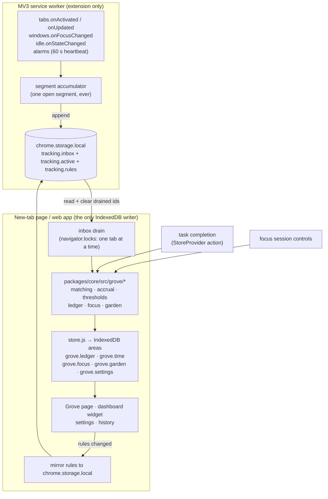

# Grove — productivity XP and the focus garden

**Status: agreed 2026-10-23. Nothing is built yet.** The owner accepted every
recommendation and every stated default, so the decisions in Deliverable 7 are settled
and the roadmap in Deliverable 8 is live.

`OPEN` and `PROPOSED` markers survive in the body as a record of what the alternatives
were and why each was chosen — they are no longer questions. Numbers labelled
*illustrative* are now the build values, and remain tunable in one place
(`grove.settings`) rather than scattered through the code.

---

## Deliverable 1 — Assessment of the existing project

### What is actually here

| Thing | Reality |
| --- | --- |
| Repo shape | npm workspaces: `packages/core` (domain, no DOM), `apps/web` (Vite 8 + React 19 + Tailwind 4, plain JSX), `apps/extension` (MV3 wrapper) |
| Language | Plain JS. No TypeScript, no lint, no type-check. `npm run build` and `npm test` are the only checks that exist |
| Tests | `node:test`, no framework. 208 tests across 8 files in `packages/core/test` + `apps/web/test` |
| Dependencies | React and nothing else at runtime |
| Extension | MV3. `manifest_version: 3`, `chrome_url_overrides.newtab` → the bundled app, `background.service_worker: background.js`, permissions: `["tabs"]`, no host permissions, no content scripts |
| Service worker today | 27 lines. One `chrome.action.onClicked` listener that raises an existing tab or opens one. That is all it does |
| Extension build | `tools/build-extension.mjs` copies `apps/web/dist` wholesale and drops `apps/extension/src` on top. The extension *is* the web app on a different origin |

### Storage and state

`packages/core/src/store.js` + `schema.js` + `storage.js`:

- IndexedDB `vistaar` → object store `kv`, **one record per area**. Areas today:
  `tasks`, `tags`, `notes`, `dashboard`, `sound`, `settings`, `dsa.library`,
  `dsa.progress`, `dsa.lists`, `dsa.settings`.
- Every area is validated on read by `coerceArea`. A corrupt area degrades to its
  default with a visible issue note; the app always opens.
- Writes are **debounced 250 ms and write the whole area**. The store holds the full
  area in memory and replaces it.
- `LAZY_AREAS` (`dsa.library`) are skipped at init and loaded by `ensureArea()`.
  Anything snapshotting all state must `ensureAllAreas()` first.
- Write failures are promoted to visible status (`status.writeError`), never swallowed.
- `STATE_VERSION = 2`; `transfer.js` exports `{format, version, data}` and refuses
  newer formats with a specific reason.
- Storage falls back to a labelled memory-only mode when IndexedDB is unavailable.

### Tasks

`packages/core/src/tasks.js` + the actions in `apps/web/src/app/StoreProvider.jsx`:

- A task is `{id, title, notes, due, priority, tags, recurrence, completedAt, createdAt, updatedAt}`.
- `due` is a **date-only local calendar string**. `completedAt` is an **instant**.
  `completedLocalDay()` bridges them. These must not be conflated.
- `setCompleted(id, completed)` stamps or clears `completedAt`, shows an **undo toast**,
  and — this matters for XP — **completing a recurring task spawns a brand-new task
  with a new id** rather than reopening the same one. Undo removes the spawned task
  and restores the previous `completedAt`.
- Completion counts, progress and overdue state are **derived, never stored**.

### Dashboard

`packages/core/src/layout.js` + `apps/web/src/widgets/registry.jsx` + `sections/Dashboard.jsx`:

- A coordinate grid: each widget is `{x, y, w, h, pinned, config}` on `BASE_COLUMNS = 48`.
- `compact()` floats unpinned widgets upward in their column; `moveItem`/`resizeItem`
  push only what is in the way then compact; `isValidLayout()` is the invariant.
- `projectToColumns()` reflows for narrow screens without rewriting the stored layout.
  Editing is enabled only at full width.
- A widget declares `{presentation, name, description, defaultSize, sizes, limits,
  render, Config}` in `WIDGETS`. `presentation` is `card | transparent | inset`,
  overridable per instance via `config.presentation`.
- Widgets use **container queries** (`@[11rem]:`) so they respond to their own box.
- Unknown widget types degrade visibly, never fatally.

### Sound

- `packages/core/src/sound.js` is the catalogue (14 synthesised sounds, recipes only,
  no DOM). `apps/web/src/audio/engine.js` is a **module singleton** Web Audio engine:
  `applyMix(mix, masterVolume)`, `pause()`, `resume()`, `stopAll()`, `subscribe()`.
- Audio only starts from a user gesture. A restored mix is pre-armed, never shown as
  playing while silent.

### Navigation and settings

- Hash routing (`useHashRoute`), `{section, param}`. Sections: dashboard, tasks,
  calendar, dsa, sounds, settings, about.
- `NavRail` holds `PRIMARY` + pinned Settings. `HIDEABLE_SECTIONS` in `schema.js`
  controls what can be hidden; Settings deliberately cannot be.
- `useShortcutDispatch.js` is the **only** global key listener. `shortcuts.js` is the
  single registry.
- `Settings.jsx` is `<Group title="…">` sections; export/import/reset live there.

### What is reusable as-is

The area-per-concern storage model, `coerceArea` validation, the derived-not-stored
discipline, the layout engine, the widget registry contract, the sound engine, the
toast/undo pattern, `pickForDay` determinism, `dates.js`, `newId()`, and the DSA
module layout (`packages/core/src/dsa/*`), which is the precedent for a new
subsystem with its own areas and its own schema file.

### Gaps and limitations that shape this design

1. **No focus timer exists.** The screenshot you sent is a mock. There is no timer,
   no XP, no tracking, no game. Everything here is new.
2. **The store is a single-writer design.** It caches an area in memory and writes
   the whole area, debounced. Two writers — a service worker and the new-tab page —
   would silently clobber each other. There is no change notification across contexts.
   **This is the single most important constraint in the design.** The resolution is
   in Deliverable 3: the service worker never writes to IndexedDB.
3. **Multi-tab behaviour is already an unresolved decision** (AGENTS.md). Website
   tracking makes it sharper: two new-tab pages open at once would both try to drain
   the tracking inbox.
4. **The web app and the extension are the same build on two origins.** Anything using
   `chrome.*` must be feature-detected, and the product must still make sense at
   `localhost:5173` with no tracking at all.
5. **The extension has no host permissions and no content scripts.** Keeping it that
   way is both a privacy asset and a hard limit on what can be known about a page
   (see §4 of Deliverable 2).
6. **No browser automation.** `npm run build` proves it compiles, `npm test` proves the
   rules hold. Neither proves anything renders. Every visual claim in this project
   needs you at `npm run dev`.
7. **Service workers cannot play audio.** Web Audio is window-only, so ambient sound
   and session chimes only exist while an app tab is open.
8. **`STATE_VERSION` must go to 3** and `transfer.js` summary extended. Version 1 and 2
   files must still import, filling new areas with defaults.

---

## Deliverable 2 — Product and domain specification

### 2.1 Name

**PROPOSED: Grove.** One word, fits the nav rail, no botanical cliché collision with
Forest, and the vocabulary falls out of it (a grove, a planting, a season). "Focus
Garden" works but is close enough to the genre's generic naming to be forgettable.

**OPEN:** Grove / Focus Garden / something of yours. Everything below says "Grove".

### 2.2 The core loop

```
You work → the work is recognised → the recognition accumulates → the garden grows
```

Concretely, three earning surfaces feed one ledger:

1. **Finish a task** → XP, once per task, ever.
2. **Spend time on a site you declared productive** → XP at 15/30/45/60-minute
   thresholds, per site, per day. Extension only.
3. **Run a focus session** → XP per eligible minute, a completion bonus, Seeds, and a
   plant that grows in the Grove.

XP drives a level and gates unlocks. Seeds are spent on plants and decorations. The
Grove is where the result is visible.

### 2.3 Design principles applied

- **Calm.** No streak that can be broken, no plant that dies, no red number. The game
  never interrupts; the dashboard widget is one tile.
- **Honest.** The product says "time with the tab active", never "focus verified". See
  §2.9.
- **Optional.** Hide `grove` from the nav rail, turn off tracking, ignore XP — the
  productivity app is unchanged. XP accrues quietly whether or not you look.
- **Local.** No account, no network. Tracking data never leaves the device, and the
  extension requests no host permissions.

### 2.4 Task rewards

| Rule | Value (**proposed, tunable**) |
| --- | --- |
| Base XP for completing a task | 10 |
| Priority bonus | high +5, medium +2, low +0, none +0 |
| Daily soft cap on task XP | 120/day; beyond it, completions earn 2 XP each and are still logged |
| Awarded | Once per **task id**, ever |

**The idempotency rule, stated plainly: a task id earns XP exactly once in its
lifetime.** Reopening and re-completing earns nothing further. Editing a task earns
nothing. Changing its priority after the award does not re-price it.

This is not an arbitrary choice — it falls out of existing behaviour. A **recurring**
task that is completed spawns a *new task with a new id*, so a daily habit still earns
every day, while toggling the same checkbox earns once. Nothing new is needed to make
the common case correct.

**Undo.** The existing undo toast must revoke the award. The ledger is append-only, so
revocation appends a **reversal event** (`-10 XP`, `reverses: <eventId>`) and releases
the dedupe key, so a genuine later completion earns again. Balance is the sum of the
ledger; it never goes negative because a reversal can only cancel an event that exists.

**Deleting a task** does not revoke XP. The work happened. (Alternative — revoke on
delete — punishes tidying up. **OPEN**, but I recommend keeping it.)

**Soft cap, not hard.** A hard zero after N tasks teaches people to stop ticking boxes,
which damages the task app to protect the game. 2 XP keeps the ledger honest and the
feedback alive.

### 2.5 Productive-website rules

A rule is user-created. There is no bundled list of "productive" sites and no judgement
baked into the product.

```
WebsiteRule {
  id, domain, label, category,
  productive: true,            // false = tracked for insight, earns nothing
  includeSubdomains: true,
  dailyCapXp: null,            // null = inherit the global cap
  enabled: true
}
```

**Domain matching.** Exact label-boundary match on the **host**, not substring:

- `leetcode.com` matches `leetcode.com`; with `includeSubdomains`, also
  `*.leetcode.com`.
- It never matches `notleetcode.com`, `leetcode.com.evil.test`, or `myleetcode.com`.
- Implementation: lowercase the host, strip a trailing dot, then
  `host === domain || (includeSubdomains && host.endsWith('.' + domain))`.
- Paths, query strings and ports are ignored entirely and never stored.
- `www.` is stripped from both sides at normalisation time, so a rule for `github.com`
  covers `www.github.com` without the subdomain switch.

**Overlapping rules** (`youtube.com` and `music.youtube.com`): the **most specific
enabled match wins** — longest matching domain, exact beating subdomain-wildcard. Time
is attributed to exactly one rule, always. The settings UI shows which rule shadows
which, because a silently dead rule is worse than a warning.

**Invalid domains** (empty, with a scheme, with a path, with spaces, a bare TLD, an IP
with a port) are rejected at entry with the reason, in the house style.

### 2.6 Website-time thresholds

**Thresholds are per rule, per local day** — not per session, not global.

| Cumulative eligible time today on that site | Award at the crossing | Running total |
| --- | --- | --- |
| 15 min | +5 XP | 5 |
| 30 min | +10 XP | 15 |
| 45 min | +15 XP | 30 |
| 60 min | +20 XP | 50 |
| beyond 60 min | 0 | 50 |

(**Illustrative values.** The shape — rising rewards, hard stop at 60 — is the proposal;
the exact numbers are yours.)

**Model comparison, as asked:**

| | A. Incremental at each threshold (**recommended**) | B. One cumulative payout per day |
| --- | --- | --- |
| Feedback | Immediate, four times a day per site | Once, at an arbitrary moment |
| Determinism | Each threshold is its own idempotent event, keyed by minute value | One event, but "when is the day over?" is a real problem — midnight, with the browser closed |
| Partial days | A 20-minute visit earns 5 XP | A 20-minute visit earns nothing until a flush that may never run |
| Failure mode | Missing one event loses 5–20 XP | Missing the payout loses the whole day |
| Complexity | Four dedupe keys per rule per day | One, but needs a reliable end-of-day trigger, which MV3 does not give you |

A is recommended. B's "pay once per day" requires the service worker to be alive at a
moment it cannot be guaranteed to be alive.

**Global daily cap across all website XP: 120 XP/day (proposed).** Without it, adding
20 rules multiplies the ceiling by 20. With it, the website channel is worth at most
roughly two and a half fully-used sites per day regardless of how many rules exist.

**Crossing several thresholds at once** (e.g. the extension was suspended and 20
minutes of credit lands in one reconciliation): award each crossed threshold in
ascending order as separate events, in one batch. The result is the same as if they had
been crossed one at a time. Never collapse them into one event; the ledger has to be
able to explain itself.

### 2.7 How time is counted (the policy, not the mechanism)

Eligible time accrues when **all** of these are true:

- The tab is the **active tab** in a **focused browser window**.
- The system idle state is `active` (not `idle`, not `locked`).
- The tab's host matches an enabled rule.
- Tracking is enabled and not paused.
- No focus session is currently running (see §2.8).

So: background tabs earn nothing. A second window that is not focused earns nothing.
Exactly one tab in the whole browser accrues at any instant, which is what makes
double-counting structurally impossible rather than merely avoided.

- **Idle:** after **60 seconds** of no input (`chrome.idle`, detection interval 60 s),
  accrual stops. The partial minute up to the idle transition is kept. On return,
  accrual resumes into the same day's total. **OPEN:** 60 s is a judgement call —
  generous enough for reading a long page, short enough that a walk away doesn't pay.
- **Locked screen:** identical to idle, immediately.
- **Window blur** (another app in front): accrual stops. Chrome reports this via
  `windows.onFocusChanged(WINDOW_ID_NONE)`.
- **Navigating within a rule's domain** (`/problems/two-sum` → `/problemset`) does not
  reset or interrupt anything; attribution is by host only, so the same rule simply
  keeps accruing.
- **Switching tabs** closes the current segment at the switch instant and opens a new
  one. Elapsed time is never counted twice because there is only ever one open segment.
- **A tab left open forever** earns nothing past the 60-minute daily threshold, and
  nothing at all while idle — the two caps are independent and both apply.
- **Restricted pages** (`chrome://`, `chrome-extension://`, the Web Store, PDF viewer,
  `about:blank`, `file://`): no rule can match them (a rule is a registrable domain),
  so they are simply never attributed. No error state.
- **Day boundary:** a segment that crosses local midnight is **split** at midnight, and
  each part credited to its own local day. Thresholds reset at local midnight.
- **Time zone change:** the local day is computed from the system clock at accrual time
  using the existing `todayISO()` convention. A traveller may get a short or long local
  day. That is correct — the calendar day is the user's, not UTC's.

### 2.8 Focus sessions

```
FocusSession {
  id, startedAt, plannedMinutes, taskId|null,
  pauses: [{ pausedAt, resumedAt|null }],
  endedAt|null, outcome: 'running'|'completed'|'ended-early'|'recovered'|'abandoned',
  plantInstanceId
}
```

- Durations **15 / 25 / 45 / 60** plus a custom value (**5–180**, proposed bounds).
- Startable from the dashboard widget, the Grove page, and the command palette.
- Optionally linked to a task. On completion, the Grove offers "mark that task done"
  — it does **not** complete it silently. That would be a reward system writing to the
  task list, which is the wrong direction of dependency.
- Pause, resume, end early. Closing the tab is not ending the session (see recovery).

**Rewards (proposed):**

| | Value |
| --- | --- |
| Eligible minute of focus | 2 XP |
| Completion bonus | 25% of the session's earned XP, only if the planned duration is reached |
| Eligible minutes capped per session | 90 |
| Seeds | 1 per completed session, +1 per full 30 eligible minutes (completed or not) |

Eligible = elapsed, minus paused time. Idle is **not** subtracted during a focus
session: that is the whole point of declaring a session — you may be reading paper,
thinking, or writing on a whiteboard. This is a deliberate asymmetry with website time
and should be stated in the UI.

**Overlap with website time — the decision you asked not to be made silently:**

| Option | Behaviour | Verdict |
| --- | --- | --- |
| **Suspend** (recommended) | While a session runs unpaused, website time is still *recorded* (flagged `duringFocus`) for statistics, but does not count toward thresholds or XP | One activity, one payment. Simple to explain: "a focus session is how that hour is paid for." Makes sessions strictly the better deal, which is the behaviour worth encouraging |
| Both, at full rate | An hour of LeetCode inside a session pays 120 + 50 | Pays twice for one hour. Hard to defend in the history view |
| Both, website halved | 120 + 25 | A third rule to explain for no product gain |

**PROPOSED: suspend.** The history screen shows the suppressed time as "covered by a
focus session" so nothing looks lost.

**Interruption rules, precisely:**

| Event | Timer | XP | Seeds | Plant |
| --- | --- | --- | --- | --- |
| Pause | stops | stops accruing | — | growth stops at the current fraction |
| Resume | continues | continues | — | continues |
| End early | ends now | per-minute XP for eligible time; **no** completion bonus | per 30 min | stays at the stage reached, planted in the Grove, marked as its own kind of thing — never destroyed |
| Tab closed, reopened before planned end | reconstructed from timestamps, still running | unchanged | — | unchanged |
| Tab closed, reopened after planned end | auto-completed at `startedAt + planned + pauses` | full, **with** bonus | full | matured |
| Browser restart mid-session | same reconstruction | same | same | same |
| Session older than planned + **12 h** on reopen | `abandoned` | eligible time credited up to the planned duration; no bonus | per 30 min | stays at its stage |
| Service worker suspended | irrelevant — elapsed is derived from timestamps, not from a ticking counter | — | — | — |

Nothing in the Grove is ever destroyed, deducted or reset by an interruption. The worst
outcome of any failure is a smaller plant.

**OPEN:** auto-completing a session whose tab was closed is forgiving by design, and it
means XP can be earned while the browser sat closed. The alternative (credit only up to
the moment the tab was last seen) is stricter but needs a heartbeat and still cannot
tell "closed the laptop" from "worked on paper". I recommend forgiving, stated plainly
in the UI.

### 2.9 What the product must never claim

- Not "focus verified". It is **elapsed time with the tab active** and, for sessions,
  **elapsed time you declared as focus**.
- Not "accurate to the second". Accrual is sampled; see the accuracy budget in
  Deliverable 6.
- Not "we know YouTube was educational". **The extension cannot see page content** and
  will not be given the permission to. A rule is a domain. If you want a sharper
  signal than that, the honest answer is a focus session, not surveillance.
- Not "your data is safe forever" — existing house rule, unchanged.

### 2.10 Privacy

- Stored: the **registrable domain**, the local day, and seconds. Nothing else.
- Never stored: URLs, paths, query strings, page titles, favicons, page content, form
  input, keystrokes, or any history for a domain without a rule.
- Non-matching sites are **not recorded at all** — not even a count. The tracker's
  memory is exactly the set of rules you created.
- No host permissions, no content scripts, no network requests, ever.
- Tracking can be paused from the widget and disabled entirely in settings; disabling
  stops it the same instant.
- "Delete all website-time data" is a single action that touches no task data.
- Export includes the Grove areas; import replaces them wholesale as it does today.

### 2.11 Economy

| Thing | Role | Spendable? |
| --- | --- | --- |
| **XP** | Lifetime score. Drives level. Gates what is *available* to unlock | **No, ever** |
| **Level** | Derived from total XP; purely a milestone and a gate | n/a |
| **Seeds** | Earned from completed focus sessions. Spent on plants and decorations | Yes |
| **Plants / decorations** | Permanent once owned | n/a |
| **Plant growth** | Per-instance, earned by one session's eligible time | n/a |

This answers the brief's question directly: XP **only gates**, it is never spent, so no
purchase can reduce it. Seeds are the spendable currency and they come only from focus
sessions, which keeps the game loop tied to the behaviour most worth encouraging.

**Level curve (proposed, integer and testable):** XP needed to go from level *L* to
*L+1* is `100 + 50 × (L − 1)`. So level 2 at 100 total, 3 at 250, 4 at 450, 5 at 700,
10 at 2 700 — in closed form, reaching level *L* costs `25L² + 25L − 50`. A good day is
150–250 XP, so early levels come in a day or two and later
ones take a week. Levels never decrease.

**Alternative worth naming:** drop Seeds, gate everything on XP level alone. Simpler by
one entity and one screen; loses the small pleasure of choosing what to spend on. I
recommend keeping Seeds, but it is the first thing to cut if the build feels heavy.
**OPEN.**

### 2.12 The garden

**Growth stages** (per plant instance, from the fraction of its session's planned
duration that was eligible): `seed` 0 → `sprout` 0.25 → `young` 0.60 → `mature` 1.00.
A plant stops where its session stopped and is planted at that stage, permanently.

**Launch catalogue (small on purpose, architecture takes more):**

- Plants (6): Sprout *(free)*, Fern, Bamboo, Cactus, Cherry Blossom, Moon Flower.
- Decorations (4): Stone, Lantern, Pond, Fallen Log.
- Environments (3): Night *(free)*, Mist, First Light.

Each has `{id, name, unlockLevel, seedCost, art}`. Unlock = level reached **and** seeds
paid. Owned forever.

**Achievements: recommended out of scope for the first build.** They are a third
progression system layered on two that are not yet proven, and the brief itself marks
them optional. The ledger makes them easy to add later — every achievement is a query
over reward events. **OPEN.**

**Milestones instead** (cheap, derived, no new storage): total focus hours, longest
session, number of plants, sites crossing 60 minutes. Displayed on the stats screen.

**No streaks.** A streak is a punishment mechanism wearing a reward's clothes, and it
is the thing that most reliably makes a calm app stressful. Day-count statistics are
fine; a counter that resets to zero and says so is not.

### 2.13 Visual identity

Follows the existing system exactly: `canvas → surface → raised → overlay`, semantic
ink tokens, one radius scale, `shadow-card/raised/overlay`, no gradients, no glass.

The one new thing: **plants are the only place in the entire app where hue appears for
its own sake.** That is a deliberate, narrow exception to "hue only where it carries
meaning" — in the Grove, the hue *is* the meaning. It is scoped to plant artwork,
never to chrome, text, borders, or state.

Plant art: inline SVG, drawn in-repo, two to four stops of desaturated botanical green
plus one accent per species. No image files, no licences, no downloads, scales to any
widget size, theme-aware. The reference screenshot's look (a lit plant against
near-black, everything else monochrome) is exactly the target; it should be achieved
with vector art and a soft radial glow built from existing tokens, not photography.

Growth animation: a short scale/opacity transition between stages, `duration-150`-ish
and scoped, honouring `prefers-reduced-motion` like everything else. No particle
effects, no celebration bursts.

---

## Deliverable 3 — Technical architecture

### 3.1 The central constraint, and the resolution

The store reads an area into memory and writes the whole area back, debounced, with no
cross-context notification. **If the service worker also wrote to IndexedDB, the two
contexts would overwrite each other's areas.**

**The rule: the service worker never touches IndexedDB. The page is the only writer.**

The service worker's job is reduced to one thing it is uniquely able to do: observe tab
and idle events while no page is open, and append immutable, already-attributed time
segments to `chrome.storage.local`. The page drains that inbox, applies rules, awards
XP and writes IndexedDB. Rules, caps, levels and the ledger live entirely in
`packages/core` and are exercised by `node:test` with no browser at all.

### 3.2 Components



**Responsibilities:**

| Component | Owns | Must not |
| --- | --- | --- |
| Service worker | Observing events; attributing an open segment to one host; splitting at midnight and idle; appending segments | Decide XP. Know about rules beyond "does this host match one". Write IndexedDB |
| `packages/core/src/grove/*` | Every rule: matching, accrual, thresholds, caps, idempotency, level curve, session arithmetic, growth stages, migrations | Touch the DOM or `chrome.*` |
| Page / React | Draining, persisting, rendering, user gestures, audio | Contain rules |

The service worker holds a **mirror** of the rules (domain + enabled + subdomains only)
in `chrome.storage.local` so it can decide whether to open a segment at all while no
page is open. The page writes that mirror whenever rules change. The mirror is a cache;
IndexedDB stays authoritative.

### 3.3 Permissions

| Permission | Why | Have it? |
| --- | --- | --- |
| `tabs` | Read the active tab's URL. **Required** — without it `Tab.url` is empty | Already granted |
| `idle` | `onStateChanged` active/idle/locked | New |
| `alarms` | A 60 s heartbeat to close segments the worker would otherwise lose to suspension | New |
| `storage` | `chrome.storage.local` for the inbox (IndexedDB is the page's) | New |
| host permissions | **Not requested.** Never | — |
| content scripts | **None.** Never | — |

All three new permissions are install-time and non-scary in the Chrome UI (`idle`,
`alarms` and `storage` show no warning; `tabs` already shows "Read your browsing
history", which the extension already requests today). No optional-permission flow is
needed, but the Grove's first-run screen should explain in plain words what is read and
what is stored, because the Chrome warning string overstates it.

**OPEN:** whether to request `idle`/`alarms`/`storage` at install or as optional
permissions requested when tracking is first enabled. Optional permissions are more
respectful and add a denial path to design and test. I lean install-time, with tracking
**off by default** so nothing is observed until you ask for it.

### 3.4 Time accounting mechanism

One open segment at a time, in `chrome.storage.local`:

```
tracking.active = { host, startedAt, lastSeenAt, localDay }
```

- Every relevant event (tab activated, URL changed, window focus changed, idle state
  changed) and every 60 s alarm runs the same function: **close the open segment, then
  open a new one if conditions allow.** One code path, no special cases.
- Closing a segment credits `min(now − lastSeenAt, MAX_TICK)` where **`MAX_TICK` = 150 s**
  (2.5 × heartbeat). This is the suspension guard: if the worker was asleep for an hour
  with a tab open, at most 150 seconds are credited for that gap, and only if the
  user was active at the moment of suspension. An unattended machine cannot farm XP.
- `lastSeenAt` is written on every heartbeat, so the worker's death loses at most one
  heartbeat of credit.
- **Clock changes:** `now − lastSeenAt < 0` → discard the interval, reset `lastSeenAt`,
  log nothing. `> MAX_TICK` → clamp. A system clock jump can therefore shift which
  local day gets credit, but can never fabricate time.
- **Midnight:** on close, if `localDay !== todayISO()`, split the interval at local
  midnight and append two segments.
- Segments are appended as `{id, host, localDay, seconds, closedAt}` with a
  `newId('seg')` id. The inbox is capped at 2 000 segments (≈ weeks of use); on
  overflow the **oldest** are merged by `(host, localDay)` rather than dropped.

### 3.5 Drain and reconciliation

On app start, on window focus, and every 60 s while open:

1. Acquire `navigator.locks.request('grove.drain', …)` so only one tab drains. (This
   is the narrow, low-risk resolution of the open multi-tab question — it covers the
   drain only, not the whole store.)
2. Read `tracking.inbox`.
3. For each segment, in `closedAt` order: resolve the host against the rules
   (most-specific wins), skip unmatched, add seconds to `grove.time[localDay][ruleId]`,
   **but only if the segment id is not already in the seen-set**.
4. Compute which thresholds the new totals crossed; emit reward events in ascending
   order through the ledger's idempotent append.
5. Write the areas, then remove exactly the drained segment ids from
   `chrome.storage.local`.

Crash-safety: the seen-set is written **in the same area update** as the totals, before
the inbox is cleared. If the page dies between step 4 and step 5, the next drain sees
the same segments and rejects them by id. Awarding twice is impossible; the inbox
growing is the only failure mode, and it is self-healing.

### 3.6 Focus session state

Authoritative: the `grove.focus` area in IndexedDB, written by the page.

**Elapsed is always derived from timestamps**, never from a counter. A rendering tick
(`setInterval` 1 s) only re-renders; it never accumulates. That makes suspension, tab
throttling, sleep and restart non-events: on reopen, elapsed is recomputed from
`startedAt`, `pauses[]` and `now`, and the recovery rules in §2.8 apply.

The service worker does **not** run focus sessions. It optionally mirrors
`{endsAt, plannedMinutes}` to `chrome.storage.local` for one purpose: a
`chrome.notifications` chime when a session ends with no tab open. **OPEN** — this
needs the `notifications` permission and is cut by default.

### 3.7 Degradation outside the extension

`packages/core` never imports `chrome.*`. The web app at `localhost:5173` gets tasks XP,
focus sessions and the full Grove; website tracking shows a single explanatory card
("Website time needs the Chrome extension"). The capability check is
`typeof chrome !== 'undefined' && chrome.tabs && chrome.storage` evaluated once.

### 3.8 New files (sketch, nothing written yet)

```
packages/core/src/grove/
  schema.js      areas, defaults, coerceGroveArea, migrations
  rules.js       domain normalisation, matching, specificity, validation
  accrual.js     segment → time record, day splitting, caps
  thresholds.js  threshold crossing → reward events
  ledger.js      append, idempotency keys, reversal, balance, rollup
  level.js       level curve, progress to next
  focus.js       session arithmetic, recovery, outcomes, rewards
  garden.js      catalogue, unlocks, growth stages, seed economy
  index.js       re-export (the existing dsa/ precedent)
apps/extension/src/
  background.js  (extended: the existing launcher + the tracker)
  tracker.js     segment accumulator, chrome.* only, no rules
apps/web/src/sections/grove/
  GroveSection.jsx  Session.jsx  Collection.jsx  Stats.jsx  GroveSettings.jsx
apps/web/src/grove/
  useFocusSession.js  useGroveDrain.js  plants.jsx (SVG art)
packages/core/test/grove.test.js
```

---

## Deliverable 4 — Data model, reward rules, migrations

### 4.1 Areas

Five new areas, split by write frequency exactly as `dsa.*` is:

| Area | Contents | Write frequency | Lazy? |
| --- | --- | --- | --- |
| `grove.settings` | rules, thresholds, caps, focus defaults, game prefs, tracking on/off | rare | no |
| `grove.time` | per-day per-rule seconds + awarded thresholds + drained segment ids | hot, small | no |
| `grove.ledger` | reward events, rolled up past 180 days | moderate | no |
| `grove.focus` | sessions + the active one | hot while a session runs | no |
| `grove.garden` | unlocks, plant instances, arrangement, seeds spent | moderate | no |

None are lazy: the dashboard widget needs the balance, the level and the active session
on first paint. Size is bounded by the rollup in §4.4, so eager loading stays cheap
(target: all five under 300 KB after a year — see Deliverable 6).

### 4.2 Schemas

```js
// grove.settings
{
  trackingEnabled: false,        // off until you turn it on
  trackingPaused: false,
  idleSeconds: 60,
  rules: [ WebsiteRule ],
  thresholds: [                  // ascending, validated
    { minutes: 15, xp: 5 }, { minutes: 30, xp: 10 },
    { minutes: 45, xp: 15 }, { minutes: 60, xp: 20 },
  ],
  dailyWebsiteCapXp: 120,
  dailyTaskCapXp: 120,
  taskBaseXp: 10,
  taskPriorityBonus: { high: 5, medium: 2, low: 0, none: 0 },
  focus: { defaultMinutes: 25, options: [15,25,45,60], xpPerMinute: 2,
           completionBonusPct: 25, maxEligibleMinutes: 90,
           suspendWebsiteXp: true },
  soundMixId: null,              // optional ambient mix for sessions
  chimeOnComplete: true,
}

// grove.time  — keyed by local day, pruned to 90 days
{
  days: {
    '2026-10-23': {
      rules: { rule_abc: { seconds: 2840, awarded: [15, 30, 45],
                           focusCoveredSeconds: 600 } },
      websiteXp: 30, taskXp: 40,          // today's cap counters
    }
  },
  seenSegments: [ 'seg_…' ],              // last 5 000, FIFO
}

// grove.ledger
{
  events: [{
    id, key,                 // key = the idempotency key; unique
    at,                      // instant
    localDay,                // the day it counts toward
    source: 'task'|'website'|'focus'|'adjustment',
    xp,                      // may be negative for a reversal
    seeds: 0,
    ref: { taskId } | { ruleId, minutes } | { sessionId, part: 'time'|'bonus' },
    reverses: eventId|null,
    note: 'Completed “Review PRs” (high)',
  }],
  rollups: [{ localDay, xp, seeds, bySource: {…} }],   // older than 180 days
  lifetime: { xp, seeds, seedsSpent },                 // see §4.5
}

// grove.focus
{ active: FocusSession|null, sessions: [FocusSession] }   // last 500

// grove.garden
{
  unlocked: ['plant_sprout','env_night'],
  plants: [{ id, speciesId, sessionId, stage, plantedAt, x, y }],  // last 400
  selectedSpeciesId: 'plant_sprout',
  environmentId: 'env_night',
}
```

### 4.3 Idempotency keys

One unique key per earnable thing. The ledger refuses a duplicate key, silently and
without error — that is the whole mechanism.

| Source | Key |
| --- | --- |
| Task | `task:<taskId>` |
| Website threshold | `site:<ruleId>:<localDay>:<minutes>` |
| Focus elapsed | `focus:<sessionId>:time` |
| Focus bonus | `focus:<sessionId>:bonus` |
| Reversal | `rev:<originalEventId>` |

Consequences that fall out, with no extra code: re-completing a task earns nothing; a
re-drained segment cannot re-cross a threshold; an extension reload cannot repay a day;
a focus session cannot be paid twice however many times recovery runs.

Note `focus:<sessionId>:time` is written **once, at the end of the session**, not
incrementally — a running session shows projected XP, which is a UI value, not a ledger
entry. If a session is recovered and completed twice by two tabs, the key rejects the
second.

### 4.4 Derived vs stored

**Stored:** reward events, website seconds, awarded threshold markers, sessions, owned
unlocks, plant instances, settings.

**Derived, never stored:** XP balance, level, progress to next level, XP earned today,
per-source breakdowns, totals by day, plant stage (from its session), what is
affordable, streak-ish statistics, caps remaining.

**The one exception:** `ledger.lifetime` and the per-day cap counters in `grove.time`
are *cached* derivations, because recomputing the balance by summing a year of events
on every paint is wasteful. They are rebuilt from the ledger on load if they disagree,
and a test asserts `lifetime === sum(events) + sum(rollups)`.

**Rollup:** events older than 180 days collapse into one `rollups` row per day. The
ledger stays explorable for half a year and bounded forever.

### 4.5 Reward formulas

```
taskXp(task)      = base + priorityBonus[task.priority]
                    capped: if todaysTaskXp >= dailyTaskCapXp then 2

websiteXp(rule, day) = for each threshold t where seconds >= t.minutes*60
                       and t.minutes not in awarded:
                         award min(t.xp, remaining global daily website cap)
                       (awards stop entirely at 60 minutes)

focusXp(session)  = min(eligibleMinutes, maxEligible) * xpPerMinute
focusBonus        = completed ? round(focusXp * completionBonusPct/100) : 0
seeds(session)    = (completed ? 1 : 0) + floor(eligibleMinutes / 30)

eligibleMinutes   = floor((endedAt - startedAt - totalPausedMs) / 60000)

level(totalXp)    = largest L where cumulative(L) <= totalXp
cumulative(L)     = sum over i in 1..L-1 of (100 + 50*(i-1))
```

A day where you finish 6 tasks, spend an hour on two tracked sites and run two
25-minute sessions: 6×~12 + 2×50 + 2×(50+13) = ~298 XP, 4 seeds. Level 4 by day two,
level 10 in about two weeks. **Illustrative; tune before build.**

### 4.6 Migration

- `STATE_VERSION` 2 → **3**. Five new areas, each defaulting cleanly when absent.
- Version 1 and 2 exports still import: `coerceArea` fills the new areas with defaults,
  exactly as it does for `dsa.*` today.
- `transfer.js` summary gains `groveXp`, `focusSessions`, `plants`, `websiteRules`.
- No migration of existing data is needed — there is nothing to migrate from. This is
  the easy direction; the forward-compatibility rule (a newer export is refused with a
  specific reason) is already in place.
- **Migration failure policy, unchanged from the house rule:** one bad area degrades to
  its default with a visible note. Specifically, a corrupt `grove.ledger` loses XP
  history but **not** the garden: unlocks live in `grove.garden` and plants are owned,
  not computed. That split is deliberate — it means the worst storage failure costs you
  a number, not your garden.

---

## Deliverable 5 — UX structure

### 5.1 Dashboard widget — `grove`

Registry entry: `presentation: 'card'`, `defaultSize {w:4,h:4}`, sizes
`['small','tall','wide','large','column']`, `limits {minW:2,minH:2,maxW:48,maxH:8}`.
Draggable, resizable, compaction-compatible, persisted — it is an ordinary widget and
gets no special treatment. Container queries drive what it shows:

| Width | Shows |
| --- | --- |
| < 9rem | Plant, timer figure, play/pause |
| 9–13rem | + level and XP-to-next meter |
| > 13rem | + duration chips and "Open Grove" |

Idle state: the selected plant, `25:00`, a play button, level and progress.
Running: the plant at its current stage, the countdown, pause/end.
It never shows the collection, the stats or the settings — that is the page's job.

An optional second widget, **`xpSummary`** (`{w:4,h:2}`): today's XP, the level meter,
and three small figures (tasks / sites / focus). Separate so the Grove widget stays
about the garden and this one stays about the numbers. Both are opt-in from the widget
picker; neither is added to the default layout.

### 5.2 The Grove page — `#/grove`

Nav rail entry between Calendar and DSA (hideable; added to `HIDEABLE_SECTIONS`).
Tabs, following the `DsaSection` precedent: **Session · Collection · Stats · Settings**.

- **Session** — the full-bleed scene: plant centred, large countdown, duration chips,
  task link, start/pause/end, ambient-sound toggle wired to the existing engine, and a
  one-line reward summary on completion. This is the screen in your reference image and
  it should be the calmest in the app: no chrome beyond what is listed.
- **Collection** — plants / decorations / environments, locked items shown with their
  requirement ("Level 4 · 3 seeds"), never hidden. Locked is a goal; hidden is a
  mystery, and mysteries are for games with a marketing budget.
- **Stats** — 7/30/90/all. Sessions, total focus time, XP by source, top sites by time,
  recent ledger entries in plain language ("+15 XP · 45 minutes on leetcode.com").
  This is the auditable history view the brief asks for.
- **Settings** — game preferences only: default duration, chime, ambient mix, selected
  species, environment, reduced motion note, "reset Grove progress" (which touches
  nothing outside the five `grove.*` areas and says so).

### 5.3 App settings additions

A new `<Group title="Productive time">` in the existing Settings section:

- Tracking: off / on, and a pause switch.
- The rules table: domain, label, category, subdomains, enabled, per-rule cap. Add,
  edit, remove, with validation errors inline and shadowing warnings visible.
- Thresholds and the global daily cap (one editable row per threshold; ascending order
  enforced).
- Idle timeout.
- A short plain-language privacy paragraph — domain only, no URLs, no content, nothing
  leaves the device — with "Delete all website-time data" next to it.

Task XP and focus XP tuning stay **out of settings**. Exposing every multiplier invites
fiddling with a scoring system whose only user is the person fiddling. The two things a
user genuinely wants to control are *which sites count* and *how long a session is*;
both are first-class. **OPEN** if you disagree.

### 5.4 Command palette and shortcuts

Add: "Start a focus session", "Start a 25-minute session", "End the focus session",
"Go to the Grove". Palette only. **No new global key listener** — if a shortcut is
wanted it goes through `shortcuts.js`, which is the single registry.

### 5.5 Copy and tone

"Grown over 4 sessions", not "Level up!". "Covered by a focus session", not "blocked".
"Time with this tab active", not "focus time". No exclamation marks, no mascot, no
nudge notifications.

---

## Deliverable 6 — Testing and acceptance criteria

Everything in `packages/core/src/grove/*` is pure and testable under `node:test` with no
browser — which is precisely why the rules live there and not in the worker.

### 6.1 Unit tests (`packages/core/test/grove.test.js`)

**Domain matching**
- `leetcode.com` matches `leetcode.com`, `www.leetcode.com`, and with subdomains
  `contest.leetcode.com`.
- It does **not** match `notleetcode.com`, `leetcode.com.evil.test`, `myleetcode.com`,
  or `leetcode.co`.
- Ports, paths, queries, fragments and trailing dots are ignored.
- Most-specific wins: with rules for `youtube.com` and `music.youtube.com`,
  `music.youtube.com` is attributed to exactly one of them, the specific one.
- Invalid rule input is rejected with a reason, not coerced.

**Accrual**
- Segments on the same day and rule sum.
- A segment crossing local midnight splits, and each half lands in its own day.
- A segment longer than `MAX_TICK` is clamped.
- A negative interval (clock moved back) contributes zero.
- A segment whose id is already in `seenSegments` contributes zero on re-drain.

**Thresholds**
- 14 min → nothing. 15 → one event, 5 XP.
- A single 61-minute drain emits exactly four events, ascending, totalling 50 XP.
- Minute 61 onward emits nothing.
- Two rules each reaching 60 min emit 100 XP; with a 120 cap, a third emits 20 then
  stops.
- Re-running the same drain emits nothing new, and the balance is unchanged.

**Task rewards**
- Complete → one event. Reopen → no reversal event on its own. Re-complete → nothing.
- Undo within the toast → a reversal; balance returns to the prior value; a later
  genuine completion earns again.
- A recurring task completed on three days earns three times (three task ids).
- Past the daily cap, completions earn 2 and are still recorded.

**Focus**
- Pause excludes paused time from eligible minutes, to the second.
- End early: time XP, no bonus, correct seeds, plant stage matches the fraction.
- Complete: time XP + bonus + seeds, plant mature.
- Recovery: a session reconstructed after a restart yields identical numbers to one
  that was watched the whole time.
- A session older than 12 h is `abandoned` with capped credit.
- Running recovery twice awards once (key collision).
- With `suspendWebsiteXp`, website seconds during the session are recorded as
  `focusCoveredSeconds` and award nothing.

**Ledger and level**
- `lifetime.xp === sum(events) + sum(rollups)` after any sequence of operations.
- Duplicate keys are rejected; the balance is unaffected.
- Balance is never negative.
- Level boundaries are exact at 100 / 250 / 450 / 700; level never decreases.
- Rollup preserves totals exactly across the 180-day boundary.

**Schema and migration**
- `coerceGroveArea` turns every malformed shape into a valid default with an issue
  string, and never throws.
- A v1 and a v2 export import cleanly with Grove areas defaulted.
- A v3 export round-trips identically.
- A corrupt `grove.ledger` leaves `grove.garden` intact (the deliberate split).

**Layout**
- The Grove widget passes the existing widget-registry test suite: it declares valid
  sizes within its limits, and `isValidLayout()` holds after add / move / resize /
  compact — the same assertions the existing widgets are held to.

### 6.2 What tests cannot cover, and how it gets verified

| Needs | How |
| --- | --- |
| Service worker suspension and revival | Manual: load unpacked, `chrome://serviceworker-internals`, stop the worker, keep browsing, confirm credit resumes within one heartbeat and no gap is paid |
| Real idle and lock | Manual: idle 2 min, lock the screen, confirm accrual stops within `idleSeconds + 60` |
| Multi-window attribution | Manual: two windows, confirm only the focused one accrues |
| Restricted pages | Manual: `chrome://settings`, Web Store, a PDF — confirm nothing accrues and nothing errors |
| Permission denied / tracking off | Manual + unit: the settings card and the Grove still work with zero website data |
| Browser restart mid-session | Manual: start a session, quit Chrome, reopen, confirm the timer and reward match |
| Every visual and responsive claim | **You, at `npm run dev`.** There is no browser automation in this repo and none is proposed |

The manual list becomes a written checklist in the repo, run before the feature is
called done. I will not claim any of it passed unless it was actually run.

### 6.3 Acceptance criteria (measurable)

1. **No duplicate awards.** Across any sequence of drains, reloads, recoveries and
   re-completions, each idempotency key is paid at most once **within the 180-day
   ledger window**. Asserted by test. Rolled-up days keep totals, not keys, which is
   what bounds storage; website keys are day-scoped and focus keys belong to a finished
   session, so neither can recur. A task id could, but only by being reopened and
   re-completed more than 180 days later — work genuinely done twice, half a year
   apart. That is a deliberate bound, recorded here rather than left to be discovered.
2. **Accounting integrity.** `lifetime.xp` equals the ledger sum after every operation.
   Asserted by test.
3. **Accuracy budget — stated honestly.** Website time is accurate to **±60 seconds per
   transition** and never over-counts: the clamp guarantees recorded time ≤ real active
   time. The product says "approximate" and never "to the second".
4. **Bounded growth.** After a simulated year of heavy use (8 sites, 10 sessions/week,
   20 tasks/day), the five `grove.*` areas total **under 300 KB**. Asserted by a test
   that generates the data and measures `JSON.stringify` length.
5. **No leakage.** No recorded field contains a path, query, title or non-rule domain.
   Asserted by test over the segment and time-record shapes, plus a grep in review.
6. **Zero network.** No `fetch`/`XMLHttpRequest` anywhere in `grove/` or the tracker.
   Asserted by a source grep in the test suite (the repo already treats "makes no
   external request" as a property worth protecting).
7. **Degradation.** With tracking off, with permissions absent, and on
   `localhost:5173`, the Grove opens, sessions run and XP accrues from tasks and
   sessions. Asserted by test + manual.
8. **Nothing is destroyed.** No code path reduces `unlocked`, removes a plant, or
   decreases a level. Asserted by test over a long randomised operation sequence.
9. **The dashboard invariant holds.** `isValidLayout()` after every Grove-widget
   operation.
10. **One global key listener.** Unchanged: `useShortcutDispatch` remains the only one.

---

## Deliverable 7 — Finalisation review

### Settled by your brief (no decision needed)

Local-first, no backend, no telemetry, no leaderboard. User-defined productive sites.
Forgiving interruptions. One authoritative ledger with idempotent processing. Thresholds
at 15/30/45/60 with 60 as the ceiling. Two entry points (widget + page). Original art
and name. Monochrome house style. No implementation until you approve.

### Settled — accepted 2026-10-23

| # | Decision | Recommendation |
| --- | --- | --- |
| 1 | Service worker never writes IndexedDB; inbox in `chrome.storage.local`, page drains | **Architectural, and the one I would not compromise on** |
| 2 | Task XP is once per task id, ever; recurrence gives the daily case for free | Yes |
| 3 | Undo appends a reversal and releases the key | Yes |
| 4 | Incremental threshold awards (model A), not a daily payout | Yes |
| 5 | Thresholds are per rule, per local day; global daily website cap 120 | Yes |
| 6 | Focus sessions suspend website XP; suppressed time is still shown | Yes |
| 7 | XP is never spendable; Seeds are the currency, earned only from sessions | Yes |
| 8 | Five `grove.*` areas, none lazy, split by write frequency | Yes |
| 9 | Rules, caps and curves live in `packages/core`, testable with no browser | Yes |
| 10 | Permissions: add `idle`, `alarms`, `storage`; never host permissions or content scripts | Yes |
| 11 | No streaks, no achievements in the first build; milestones instead | Yes |
| 12 | Plants are the one place hue appears decoratively; inline SVG only | Yes |
| 13 | XP tuning stays out of user settings; sites and durations are user-controlled | Yes |
| 14 | `navigator.locks` for drain leadership only | Yes — narrow, and does not pre-decide the wider multi-tab question |

### Also settled — the stated defaults were accepted

| # | Question | Answer |
| --- | --- | --- |
| A | Name | **Grove** |
| B | All the numbers (XP per task, per threshold, per focus minute, bonus %, caps, level curve) | **As written in Deliverable 4**, held in `grove.settings` so they are tunable without a code change |
| C | Session recovery | **Forgiving** — a session whose tab was closed auto-completes at its planned end, stated plainly in the UI |
| D | Seeds, or XP-gating alone | **Keep Seeds** |
| E | Permissions | **Install-time** (`idle`, `alarms`, `storage`), tracking **off by default** |
| F | Idle timeout | **60 s**, editable in settings |
| G | End-of-session notification | **No.** `notifications` is not requested |
| H | Deleting a task | **Keep its XP.** The work happened |
| I | Achievements in v1 | **No.** Derived milestones instead |
| J | Grove's place in navigation | **Nav rail slot**, hideable, between Calendar and DSA |

### The scope risk, resolved by sequencing

The last risk on the record — that this is a large surface for an app whose DSA section
is paused at foundation-only — is answered by the phase order below rather than by
cutting anything now. Phases 0–4 are the complete loop. Phase 5 (Seeds spending, the
collection screen, the second widget) is the third of the work that can be dropped or
deferred without breaking anything built before it, and the decision point arrives
naturally when Phase 4 lands.

---

## Deliverable 8 — Implementation roadmap

Six phases. Each one leaves the tree building, the suite green and the app usable;
none is a half-landed refactor. Nothing is committed at any point.

### Phase 0 — The ledger foundation ✅ built 2026-10-23, uncommitted

Core only. Nothing visible in the app. `npm test` 226 passing, `npm run build` clean.

- New: `packages/core/src/grove/{schema,ledger,level,index}.js`.
- Changed: `schema.js` — `STATE_VERSION` 2 → 3, `AREAS` gains the five `grove.*` areas,
  `coerceArea` delegates to `coerceGroveArea`. `transfer.js` — summary gains
  `groveXp`, `focusSessions`, `plants`, `websiteRules`.
- Tests: idempotency keys, reversal, `lifetime === sum(events) + sum(rollups)`, balance
  never negative, level boundaries at 100/250/450/700, rollup preserves totals,
  `coerceGroveArea` never throws, v1/v2 imports default cleanly, v3 round-trips,
  corrupt `grove.ledger` leaves `grove.garden` intact.
- Done when: `npm test` and `npm run build` pass and an export/import round-trip of
  existing data is unchanged.

**This is the phase to review hardest.** The ledger is the product's memory, and a
wrong shape here is a migration over data that cannot be regenerated.

### Phase 1 — Task XP ✅ built 2026-10-23, uncommitted

The first earning surface, on machinery that already exists.

- Changed: `StoreProvider.setCompleted` awards through the ledger; the existing undo
  appends a reversal and releases the key; daily cap counters in `grove.time`.
- The only UI change: the completion toast gains `· +12 XP`.
- Tests: once per task id ever; reopen then re-complete earns nothing; undo reverses and
  a later genuine completion earns again; a recurring task completed on three days earns
  three times; past the cap, completions earn 2 and are still recorded.
- Done when: ticking a box moves a number that survives a reload.

### Phase 2 — Focus sessions and the Grove page ✅ built 2026-10-23, uncommitted

The core loop becomes real, and the first thing worth looking at appears. Shipped as planned; the Collection,
Stats and Settings tabs arrived with Phase 5 straight after.

- New: `packages/core/src/grove/focus.js`; `apps/web/src/sections/grove/GroveSection.jsx`
  + `Session.jsx`; `apps/web/src/grove/{useFocusSession.js,plants.jsx}`.
- Changed: `App.jsx` route, `NavRail` entry, `HIDEABLE_SECTIONS`, command palette
  entries ("Start a focus session", "Start a 25-minute session", "End the focus
  session", "Go to the Grove"). No new key listener.
- Art: the free species only — Sprout, four stages, inline SVG, plus the Night
  environment.
- Ambient sound wired to the existing engine singleton, user-gesture gated as today.
  **Not built** — the session screen does not yet start a sound mix. The engine and the
  `soundMixId` setting are both in place; only the hookup is missing.
- Tests: pause excludes paused time exactly; end early gives time XP and no bonus;
  completion gives bonus and seeds; recovery after a restart yields numbers identical to
  a watched session; a 12-hour-old session is `abandoned` with capped credit; running
  recovery twice awards once.
- **Needs you:** start a session, quit Chrome, reopen, confirm the timer and the reward
  match. I cannot verify that here.

### Phase 3 — The dashboard widget ✅ built 2026-10-23, uncommitted

- New: a `grove` entry in `WIDGETS` — `card`, `{w:4,h:4}`, sizes
  `['small','tall','wide','large','column']`, three container-query tiers.
- Tests: it passes the existing widget-registry suite; `isValidLayout()` holds after
  add / move / resize / compact.
- **Needs you:** drag, resize and compact it at desktop and phone widths. The
  arithmetic audit in AGENTS.md can catch overflow without a renderer; it cannot tell
  you whether it looks right.

### Phase 4 — Website tracking ✅ built 2026-10-23, uncommitted

The only phase that touches the extension, and the one most likely to be subtly wrong.

- New: `packages/core/src/grove/{rules,accrual,thresholds}.js`;
  `apps/extension/src/tracker.js`; `apps/web/src/grove/useGroveDrain.js`.
- Changed: `apps/extension/src/manifest.json` gains `idle`, `alarms`, `storage`;
  `background.js` keeps its launcher and adds the tracker; `Settings.jsx` gains the
  "Productive time" group; the Grove shows the degradation card on `localhost`.
- Tests: label-boundary matching (`notleetcode.com` never matches); most-specific rule
  wins; midnight split; `MAX_TICK` clamp; negative interval contributes zero; re-drained
  segment ids contribute zero; a 61-minute drain emits exactly four ascending events
  totalling 50 XP; global cap; re-running a drain emits nothing.
- **Needs you — the manual checklist**, which I will write into the repo: service
  worker stopped from `chrome://serviceworker-internals` and revived; two minutes idle;
  a locked screen; two windows; `chrome://settings` and the Web Store; a browser
  restart. None of this is reachable from `node:test`.
- Done when: the accuracy claim holds in the direction that matters — recorded time is
  never more than real active time.

### Phase 5 — Collection, stats and the economy ✅ built 2026-10-23, uncommitted

Built rather than dropped, at the owner's instruction. The Grove therefore has its
four tabs, the catalogue is live and seeds are spendable.

- New: `grove/garden.js` (seed economy, unlocks); `Collection.jsx`, `Stats.jsx`,
  `GroveSettings.jsx`; the remaining five species, four decorations, two environments;
  the optional `xpSummary` widget.
- Tests: nothing is ever destroyed (randomised operation sequence never reduces
  `unlocked`, removes a plant or decreases a level); bounded growth — a simulated year
  of heavy use keeps the five areas under 300 KB.

### Running through all of it

- Never commit; everything stays uncommitted for your review.
- No new runtime dependency is needed by any phase. If one ever looks necessary, I stop
  and ask.
- `npm test` and `npm run build` after every phase. They are the only automated checks
  that exist, and neither proves anything renders.
- Every visual, responsive and interaction claim is yours to verify at `npm run dev`.
  I will say what I could not check rather than implying it passed.

### Known risks I want on the record

- **The ledger is the product's memory.** If its shape is wrong, fixing it later means a
  migration over data that cannot be regenerated. It is worth over-thinking now and is
  the part of this design I would most like you to read closely.
- **Tracking is the part most likely to be subtly wrong**, because its failure modes
  (a suspended worker, a clock change, a sleeping laptop) are invisible and
  unreproducible in tests. The clamp and the id-based dedupe are there to make the
  wrong answer always *too little*, never too much.
- **"Productive" is a domain, not a judgement.** The brief's YouTube example cannot be
  honoured as written without reading page content, which this extension will not do.
  The product must say so rather than implying a smarter signal than it has.
- **This is a lot of surface** for an app whose DSA section is already paused at
  foundation-only. Cutting Seeds, the collection screen and the second widget would
  remove perhaps a third of the work and lose little of the loop. Worth deciding
  deliberately rather than discovering halfway.

---

*Nothing in this document has been implemented. No files outside `docs/` were touched
and nothing was committed.*
